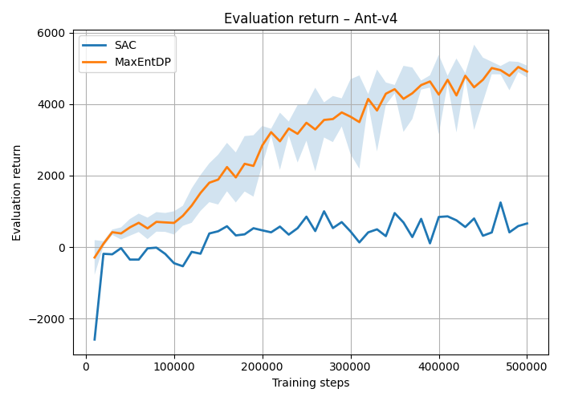
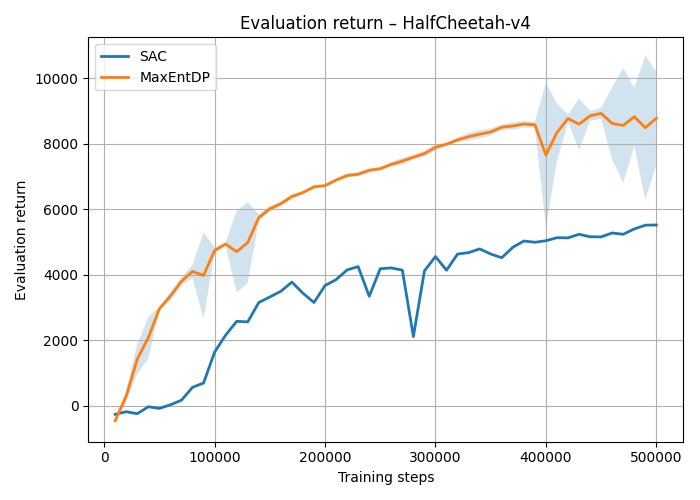
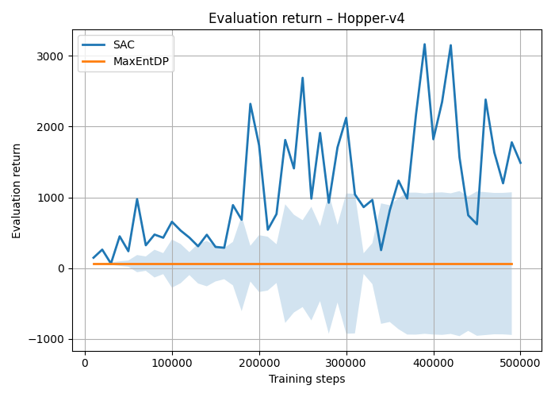
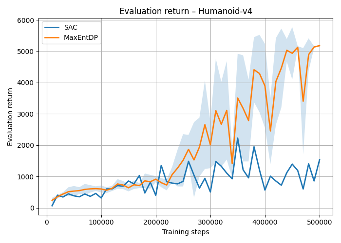
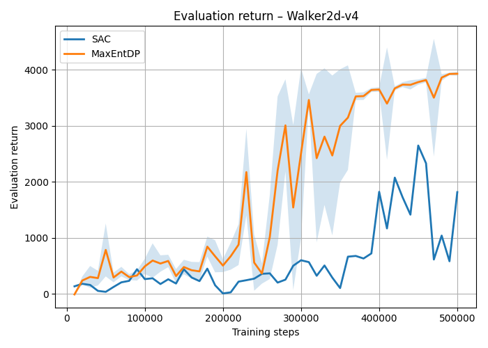
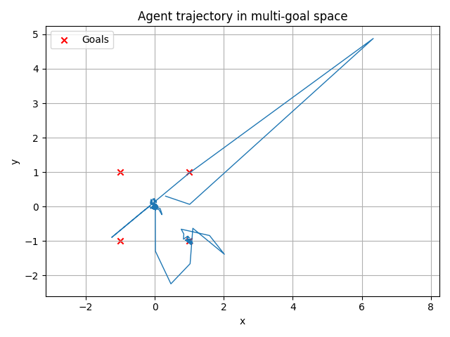
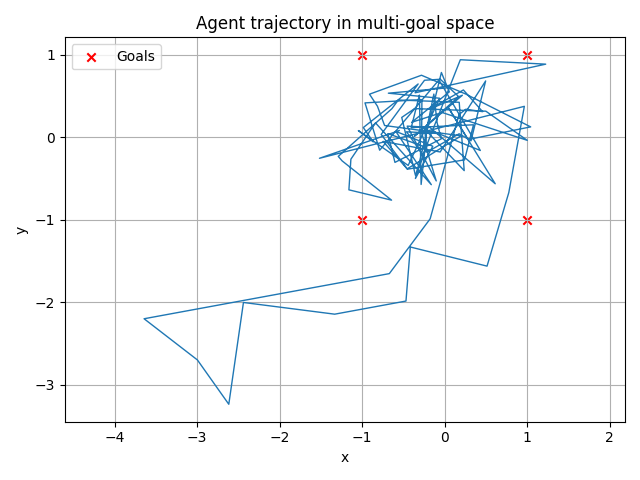

# USD-Maximum-Entropy-Reinforcement-Learning-with-Diffusion-Policy

This project was developed for the **Learning Decision Systems (Uczące się systemy decyzyjne)** course at the Faculty of Electronics and Information Technology, Warsaw University of Technology.

**Authors:** Oskar Gorgis, Marcin Kowalczyk  
**Supervisor:** Jakub Łyskawa, PhD

---

## Project Overview

The goal of this project is to recreate results from the oryginal paper *"Maximum Entropy Reinforcement Learning with Diffusion Policy"* and compare the modern **Maximum Entropy Reinforcement Learning with Diffusion Policy (MaxEntDP)** approach against the classic **Soft Actor-Critic (SAC)** algorithm utilizing a standard unimodal Gaussian policy.

Replacing the traditional Gaussian policy with a diffusion model enables the representation of complex, multimodal action distributions. Consequently, the agent explores the state-action space more effectively, avoids getting trapped in local optima, and demonstrates higher training stability. This implementation is based on the paper  and its official repository.

The experiments were conducted in two main setups:
1. **Continuous Control Benchmarks (MuJoCo):** `Ant-v4`, `HalfCheetah-v4`, `Hopper-v4`, `Humanoid-v4`, and `Walker2d-v4`.
2. **Multimodal Environment (Multi-goal 2D):** Optimization of a function with four equidistant global extrema to demonstrate the ability to explore and capture multiple alternative solutions.

---

## Repository Structure

The codebase is organized modularly, separating algorithm logic, environment definitions, utility tools, and training scripts:

```text
├── algorithms/          # Implementations of the evaluated RL algorithms
│   ├── maxentdp/        # Maximum Entropy Denoising Policy (MaxEntDP) implementation
│   └── sac/             # Reference Soft Actor-Critic (SAC) implementation
├── training/            # Execution module (train_maxentdp.py, train_sac.py), metric logging, and replay buffer
├── enviroments/         # Simulation environment definitions and wrappers
│   ├── mujoco.py        # Interface for standard MuJoCo physics environments
│   └── multigoal_point.py # Custom 2D Multi-Goal environment implementation
├── jaxrl5/              # Computational backend and utility components built on JAX
├── results/             # Output directory (model checkpoints, training logs, and generated plots)
├── main.py              # Main entry-point script to run experiments
└── requirements.txt     # List of required Python dependencies
```

---

## Requirements & Installation

To run this project, **Python 3.13.19** is required. For optimal execution speed, an **NVIDIA GPU** with the latest drivers supporting **CUDA 13** (`nvidia-*-cu12` packages) is strongly recommended.

1. Clone the repository
2. Install the required dependencies via `pip`:
   ```bash
   pip install -r requirements.txt
   ```

---

## Running the Experiments

All training and evaluation scripts can be executed via the main entry-point `main.py` or directly through the scripts located in the `training/` directory:

```bash
python main.py
```

---

## Experimental Results

Due to computational constraints and training time, the comparative MaxEntDP experiments were conducted for **500,000 environment steps**, whereas the standalone baseline SAC experiments were run for **1,000,000 environment steps**.

### 1. MuJoCo Continuous Control Benchmarks

* **Superior Returns & Convergence:** **MaxEntDP** achieves higher final episodic returns (both in training and evaluation) and converges faster across most MuJoCo benchmarks, particularly in `Ant-v4`, `HalfCheetah-v4`, `Humanoid-v4`, and `Walker2d-v4`.
* **Lower Variance & High Stability:** MaxEntDP learning curves exhibit significantly lower variance and fewer sudden performance drops compared to SAC.
* **Sustained Exploration:** Policy entropy in MaxEntDP decreases more gradually than in SAC, enabling a more thorough exploration of the state-action space before converging to optimal trajectories.

| Environment | MaxEntDP Temperature ($\alpha$ / $\beta$) | Key Observations |
| :--- | :---: | :--- |
| **Ant-v4** | `0.05` | Much faster convergence and nearly 4x higher evaluation return for MaxEntDP compared to SAC within 500k steps. |
| **HalfCheetah-v4** | `0.20` | Smooth learning curve for MaxEntDP, reaching returns above 8000 (compared to ~5000 for SAC). |
| **Hopper-v4** | `0.05` | Diffusion policy models safer action distributions in standalone runs, effectively avoiding critical states (falls) but it does not improve over time in comparison to SAC - the only case where SAC performs better. |
| **Humanoid-v4** | `0.02` | Excellent scalability of MaxEntDP in high-dimensional action spaces (evaluation return ~5000 vs. ~1500 for SAC). |
| **Walker2d-v4** | `0.01` | Rapid performance jump and highly stable bipedal locomotion achieved by MaxEntDP. |

#### Comparative Plots (SAC vs. MaxEntDP)

<p align="center">
  
  
</p>
<p align="center">
  
  
</p>
<p align="center">
  
</p>

<!-- TODO #### Detailed Metrics per Environment (Episodic Return, Entropy, Actor & Critic Losses)

<details>
<summary><b>Click to expand detailed training curves for SAC and MaxEntDP</b></summary>
<br>

**Soft Actor-Critic (SAC) - 1M Steps:**
<p align="center">
  
  
</p>
<p align="center">
  
  
</p>
<p align="center">
  
</p>

**Maximum Entropy Diffusion Policy (MaxEntDP) - 500k Steps:**
<p align="center">
  
  
</p>
<p align="center">
  
  
</p>
<p align="center">
  
</p>
</details> -->

---

### 2. Multi-Goal 2D Environment (Multimodality Demonstration)

In the 2D environment featuring 4 symmetrically placed goals, the reward function is defined as:

$$r_{t}=\frac{1}{\beta}\ln\left(\sum_{g\in G}\exp(-\beta\|g-s_{t+1}\|_{2})\right)$$

* **SAC (Gaussian Policy):** As expected for a unimodal policy, the SAC agent quickly finds a single global optimum and gets stuck in it, ceasing further exploration of the space.
* **MaxEntDP (Diffusion Policy):** The MaxEntDP agent does not stop exploring after discovering one optimum; instead, it continues to traverse the space and successfully covers multiple symmetric goal states.

<p align="center">
  
  
</p>

---

## 📚 References

1. *Maximum Entropy Reinforcement Learning with Diffusion Policy* – reference paper for this project.
2. Official MaxEntDP implementation: [diffusionyes/MaxEntDP](https://github.com/diffusionyes/MaxEntDP/tree/main).